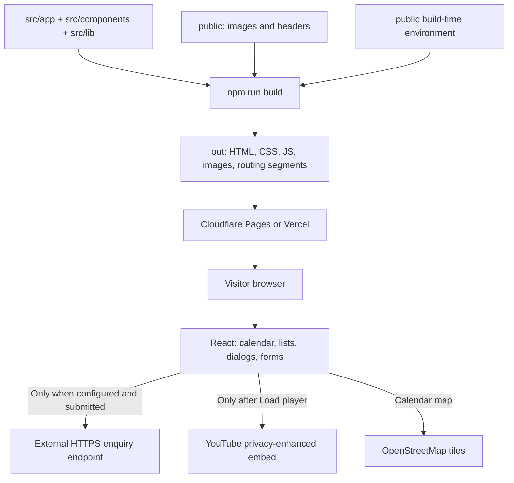
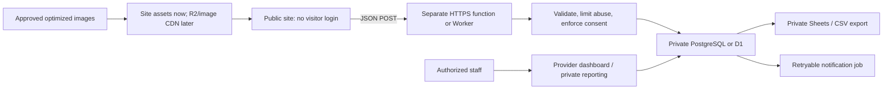

# Architecture and module map

Reviewed against the repository on 11 November 2026. **Current implementation**
and **proposed additions** are separated throughout these guides.

## 1. Executive decision

Keep the existing Next.js static export. It already produces pre-rendered pages
and does not require a continuously running Next.js server.

| Concern | Recommended starting point | When to change |
| --- | --- | --- |
| Website hosting | Cloudflare Pages for this static site; Vercel is an equally compatible alternative | Choose Vercel if the team prefers its workflow or later needs a full Next.js runtime |
| Images | Keep the current optimized files in the repository | Move growing media archives to R2 with a custom domain or an image CDN |
| Public editorial content | Existing typed TypeScript records, reviewed in Git | Add a private-sheet build importer or CMS when non-developers need frequent updates |
| Response storage | Managed PostgreSQL, for example Supabase, behind a small HTTPS backend | Use Cloudflare D1 if deliberately standardizing the backend on Workers |
| Spreadsheet access | Private export/reporting destination, not the public source of personal data | Sheets-only storage is reasonable for a small, low-volume workflow with explicit limits |
| Visitor authentication | Not required for enquiries | Staff still need protected provider/database access |
| Framework migration | Not needed for launch | Consider an Astro prototype only if measured JavaScript/performance benefits justify a rewrite |

**Simplest release:** website + local images + verified contact email. Leave forms
disabled until a real backend is tested. Do not add a database just to display
the current static content.

## 2. What has been built

- Public information and participation website with 12 addressable routes.
- Shared responsive branding, navigation, footer, typography, and section patterns.
- Seven confirmed event records, five gallery records, ten podcast episodes, and
  five social-channel links, all maintained in source.
- Twenty approved Sankalpa records and six contribution pathways.
- Day/month/year calendar, current-month upcoming list, filtered schedule,
  featured gathering, and Leaflet/OpenStreetMap venues.
- Incremental event/podcast lists and keyboard-accessible image dialogs.
- Separate Join and Contribute forms, client validation, conditional interests,
  contribution-area prefilling, and explicit disconnected states.
- SEO metadata, canonical URLs, sitemap, robots, and static not-found page.
- Local image previews and font; YouTube connects only after a visitor chooses
  to load a player.
- Static-host security-header templates and browser/accessibility regression tests.

**Not implemented:** API server, database, authentication, admin editor, live
spreadsheet synchronization, email delivery, newsletter subscription, event
registration/capacity management, payment processing, PWA, or automated social
feed. A successful build does not make these services exist.

## 3. Current architecture



### Rendering and data flow

1. Route modules import shared content and compose components at build time.
2. Next.js pre-renders the routes. `output: "export"` and `trailingSlash: true`
   in [next.config.ts](../next.config.ts) produce directory-based pages.
3. [finalize-export.mjs](../scripts/finalize-export.mjs) normalizes Windows-only
   nested `__next.*` routing segments into the filenames the browser requests.
   It refuses collisions; on non-Windows platforms it does nothing.
4. The host serves the complete export. React hydrates client components for
   navigation, lists, date handling, forms, and dialogs.
5. Changing source content or `NEXT_PUBLIC_*` configuration requires a rebuild
   and redeployment. The host does not read local environment files at request time.

Server Components here mean **build-time composition**, not an active production
server. Adding a secret or database client to a client component would expose it;
adding a runtime POST handler to a static-export app does not create an API.

## 4. Directory responsibilities

```text
ITF\
  src\
    app\                    URL routes, root layout, global CSS, metadata
    components\             Reusable presentation and browser interactions
    lib\                    Typed content, configuration, validation helpers
  public\
    images\
      itf-assets\           Official logo/source artwork and footer derivative
      <speaker>\
        event-poster\       Supplied PNG + generated WebP preview
      sankrant-sanu\
        event-photos\       Five photos and responsive derivatives
      *.webp                Hero artwork, legacy assets, podcast thumbnails
    _headers                Cloudflare Pages/Netlify response-header rules
  scripts\                  Maintenance tools; only finalizer runs during build
  tests\                    Browser, content, layout, accessibility regressions
  Architecture\
    Development\            Historical checkpoint/reference documents
  .github\                  Optional design-agent skills, agents, and hooks
  .impeccable\              Design-tool metadata/local configuration
  package.json              Commands, dependencies, supported runtime minimum
  package-lock.json         Exact dependency resolution for npm ci
  next.config.ts            Static export and image behavior
  tsconfig.json             Strict TypeScript; @/* maps to src/*
  eslint.config.mjs         Next.js ESLint configuration
  playwright.config.ts      Browser profiles and static-preview test server
  vercel.json               Vercel security headers
  netlify.toml              Existing optional Netlify deployment settings
  .env.example              Public configuration template, no credentials
  .gitignore                Dependencies, exports, test outputs, local env files
```

Generated directories such as `node_modules`, `.next`, and `out` are not source.
See the [transfer guide](./TRANSFER_AND_CLEANUP.md) before copying or cleaning.

### Route map

All paths below are served as static pages; trailing slashes are intentional.

| URL | Source under `src/app` | Responsibility |
| --- | --- | --- |
| `/` | [page.tsx](../src/app/page.tsx) | Hero, purpose, principles, pathways, latest three event dates, podcast, gallery, goals |
| `/about/` | [about/page.tsx](../src/app/about/page.tsx) | About, philosophy, purpose, journey |
| `/sankalpas/` | [sankalpas/page.tsx](../src/app/sankalpas/page.tsx) | Approved tracker and contribution pathways |
| `/events/` | [events/page.tsx](../src/app/events/page.tsx) | Updates: podcasts, events, Instagram link, gallery, social channels |
| `/calendar/` | [calendar/page.tsx](../src/app/calendar/page.tsx) | Featured event, calendar, venues, full schedule |
| `/contact-us/` | [contact-us/page.tsx](../src/app/contact-us/page.tsx) | Join and Contribute forms |
| `/support/` | [support/page.tsx](../src/app/support/page.tsx) | Contribution information and optional hosted donation link |
| `/privacy/` | [privacy/page.tsx](../src/app/privacy/page.tsx) | Published privacy notice; must be finalized when providers are selected |
| `/accessibility/` | [accessibility/page.tsx](../src/app/accessibility/page.tsx) | Features, limitations, and reporting route |
| `/philosophy/` | [philosophy/page.tsx](../src/app/philosophy/page.tsx) | Re-exports About; canonical points to `/about/` |
| `/gallery/` | [gallery/page.tsx](../src/app/gallery/page.tsx) | Re-exports Updates; canonical points to `/events/` |
| `/media/` | [media/page.tsx](../src/app/media/page.tsx) | Re-exports Updates; canonical points to `/events/` |
| Missing URLs | [not-found.tsx](../src/app/not-found.tsx) | Custom `404.html`; host must return HTTP 404 |

Compatibility routes render content; they are **not HTTP redirects**. Navigation
and the [sitemap](../src/app/sitemap.ts) use the nine primary routes.

### Shared modules and relationships

| Module | What it owns / who uses it |
| --- | --- |
| [site.ts](../src/lib/site.ts) | Validated public configuration, navigation, principles, journey, contribution categories, events, map locations, gallery, and Lakshya goals |
| [media.ts](../src/lib/media.ts) | Podcast records, featured episode, social URLs, YouTube video-ID validation |
| [sankalpas.ts](../src/lib/sankalpas.ts) | Approved tracker types/data and validated newest-first note history |
| [schedule.ts](../src/lib/schedule.ts) | IST date keys, strict event date/time parsing, ordering and display |
| [use-event-date.ts](../src/lib/use-event-date.ts) | Build-date hydration snapshot, then browser IST date; refreshes every minute and on window focus |
| [use-incremental-list.ts](../src/lib/use-incremental-list.ts) | Shared load-more state, complete-grid-row sizing, and focus on newly revealed items |
| [forms.ts](../src/lib/forms.ts) | Submission payload type and JSON transport; 15-second timeout; only confirmed success accepted |
| [metadata.ts](../src/lib/metadata.ts) | Shared title, description, canonical, and sharing metadata |
| [layout.tsx](../src/app/layout.tsx) | HTML shell, self-hosted Manrope font, Header, Footer, skip link, and default metadata |
| [globals.css](../src/app/globals.css) | All shared tokens, layouts, breakpoints, focus states, and reduced-motion behavior |

### Component responsibilities

| Group | Files | Behavior |
| --- | --- | --- |
| Shell | [header](../src/components/header.tsx), [footer](../src/components/footer.tsx) | Active links including legacy aliases, mobile menu/focus handling, no-JavaScript navigation, official branding and social links |
| Presentation | [sections](../src/components/sections.tsx), [icon](../src/components/icon.tsx) | PageIntro, SectionHeading, Principles, Journey, CTA, shared icons |
| Events | [event-list](../src/components/event-list.tsx), [event-schedule](../src/components/event-schedule.tsx) | Newest-first cards; upcoming-first/past-reversed schedule; posters and load-more |
| Calendar | [event-calendar](../src/components/event-calendar.tsx), [calendar-featured-event](../src/components/calendar-featured-event.tsx) | Day/month/year selection, current-month list, selected-period details, curated feature |
| Venues | [event-map](../src/components/event-map.tsx) | Browser-only dynamic Leaflet import; verified venue coordinates; upcoming event markers; failure notice and ordinary directions links |
| Images | [gallery-grid](../src/components/gallery-grid.tsx), [media-dialog](../src/components/media-dialog.tsx) | Responsive photo sources; native modal, arrow navigation, Escape, focus restoration, failed-image feedback |
| Media | [media-content](../src/components/media-content.tsx), [youtube-player](../src/components/youtube-player.tsx) | Podcast lists, click-to-load player, Instagram profile link and social links |
| Tracker | [sankalpa-table](../src/components/sankalpa-table.tsx) | Seven-column desktop table; expandable summaries at widths up to 1024px; source-managed note history |
| Contact | [contact-layout](../src/components/contact-layout.tsx), [submission-form](../src/components/submission-form.tsx) | Two separate forms, field/consent validation, Sankalpa query-prefill, disabled unconfigured submission, success/error state |

## 5. Important behavior and content rules

- Event status is based on the **IST calendar day**, not whether its start time
  has passed. An event remains Today until the day ends.
- Home shows the latest three event dates, including future dates; this is not
  necessarily the next three upcoming events.
- Static HTML contains the build's date snapshot. JavaScript updates date-based
  displays after hydration; rebuild periodically for fresh no-JavaScript content.
- The calendar feature currently selects the `ganeshaiah` ID explicitly in the
  route. Adding events does not automatically change this featured selection.
- Every event venue must match a verified location record. Missing coordinates
  fail explicitly rather than inventing a marker.
- Event cards, calendar feature, and poster dialogs currently use **WebP previews**.
  Original PNGs are preserved but are not automatically loaded by these viewers.
- Updates intentionally hides event category and gallery filters. `GalleryGrid`
  still supports filters for a future caller; do not describe them as visible there.
- `SocialPosts` currently renders an Instagram **profile link**, not post cards or
  a live feed. Podcasts and social links are editorially curated.
- Sankalpa IDs preserve the approved source IDs, including the gap at 20-21;
  those non-publishable records are not included. Do not renumber or fabricate rows.
- Tracker notes are empty and read-only. Add approved `{ id, updatedAt, text }`
  records in source; canonical UTC ISO timestamps and unique non-empty IDs/text
  are validated, then displayed newest first in IST.
- Extra tracker metadata retained in source is not automatically private just
  because it is not shown in a column. Never put confidential information in
  frontend source or public build inputs.
- Homepage 500+/10+/30+ figures are **goals**, not achieved impact.
- Forms retain entered values on failure, reset after confirmed success, and
  do not save drafts in browser storage. Consent to contact is not newsletter opt-in.
- Fonts and image previews are local. YouTube is opt-in; the calendar map does
  contact OpenStreetMap tile servers without a separate Load prompt.

## 6. Configuration

Copy [.env.example](../.env.example) to `.env.local` for local work. On a host, use
its environment settings instead of committing local environment files.

| Variable | Requirement / effect |
| --- | --- |
| `NEXT_PUBLIC_SITE_URL` | Canonical HTTPS site origin. Default is `https://www.indicthoughtforum.org`. Set the real domain; no subdirectory hosting is configured. |
| `NEXT_PUBLIC_FORMS_ENDPOINT` | Optional HTTPS JSON endpoint. Empty means both forms are disabled. |
| `NEXT_PUBLIC_DONATION_URL` | Optional verified HTTPS hosted payment page. Empty means online donations are disabled. |
| `NEXT_PUBLIC_CONTACT_EMAIL` | Optional verified public contact email. |

All four values are public and embedded at build time. URLs reject non-HTTPS
schemes and embedded credentials; configured email syntax is checked. Invalid
configuration fails the build. Environment changes require a fresh deployment.
No database credentials or private Google credentials belong in these variables.

## 7. Recommended production extensions (not implemented)



Keep public content and private responses separate. A database stores structured
records; an object store holds images. Store image keys/URLs in records, not large
base64 images. No visitor login is needed, but private records must never be
publicly readable. Start with one response table, not a microservice platform.

Detailed choices, schema outline, backend requirements, and spreadsheet trade-offs
are in [Data and forms](./DATA_AND_FORMS.md). Media publishing and a future CDN
migration are in [Images and media](./IMAGES_AND_MEDIA.md).

## 8. Build, deployment, and maintenance boundaries

- Use the committed lockfile with `npm ci`; retain the pinned TypeScript version
  unless making and validating a deliberate toolchain update.
- `images.unoptimized: true` means there is no runtime Next.js image optimizer.
  Produce responsive derivatives before committing media.
- Deploy all of `out`, including hashed assets and routing `.txt` files, as one
  release. Do not deploy just the homepage or use a blanket SPA rewrite.
- [public/_headers](../public/_headers) is consumed by Cloudflare Pages/Netlify;
  [vercel.json](../vercel.json) supplies Vercel headers. The local preview does
  not enforce either host's header configuration.
- The CSP permits inline framework scripts/styles and currently permits all HTTPS
  `connect-src` endpoints. Narrow that directive when the real form service is
  selected. Adding remote images requires an explicit `img-src` change.
- A static deployment has no reliable writable filesystem for enquiries.
  Never write submissions into `public`, an exported JSON file, or Git.

Use the separate [Cloudflare](./DEPLOY_CLOUDFLARE.md) or
[Vercel](./DEPLOY_VERCEL.md) runbook, then complete
[production operations](./OPERATIONS.md). Historical design decisions and local
measurements remain in [Development](./Development); they are not current
production certifications.
